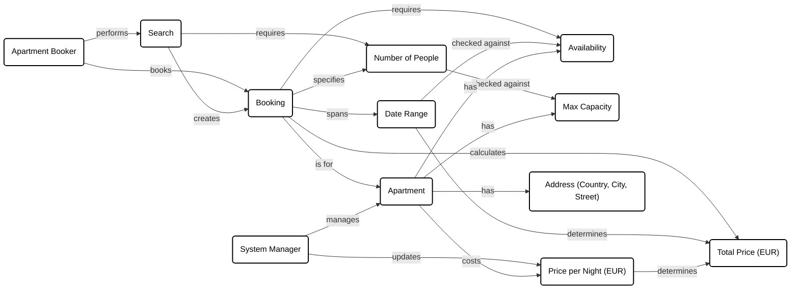

# Apartment Booking System (CLI)

**By Sebastiano Druda, Tom Springer and Jacob Wieser**

A terminal application for managing apartments, searching availability, and creating,
changing or cancelling bookings. Built with Python and SQLite using only the standard
library: no external packages, database server or web service are required.

**Release:** [Checkpoint 01](https://github.com/SebastianoDruda/apartment-booking-cli/releases/tag/checkpoint-01)
 · **Runtime:** Python 3.10+
 · **Storage:** local SQLite
 · **Interface:** interactive terminal in English

## Contents

- [Features](#features)
- [Requirements and installation](#requirements-and-installation)
- [Starting the application](#starting-the-application)
- [First booking walkthrough](#first-booking-walkthrough)
- [Roles and command reference](#roles-and-command-reference)
- [Input rules and booking behaviour](#input-rules-and-booking-behaviour)
- [Tab completion and terminal controls](#tab-completion-and-terminal-controls)
- [Repository structure](#repository-structure)
- [Architecture and data model](#architecture-and-data-model)
- [Domain concept map](#domain-concept-map)
- [Database location, backup and reset](#database-location-backup-and-reset)
- [Testing and continuous integration](#testing-and-continuous-integration)
- [Troubleshooting](#troubleshooting)
- [Current scope and limitations](#current-scope-and-limitations)
- [Contributing](#contributing)
- [Releases](#releases)
- [Authors and licensing](#authors-and-licensing)

## Features

- Two selectable roles: **System Manager** and **Apartment Booker**.
- Apartment creation with name, address, capacity and nightly price in EUR.
- Nightly price updates and apartment removal.
- Booking creation, date/guest-count changes and cancellation.
- Availability search by date range and party size, with booking directly from results.
- Real-calendar validation, capacity checks and overlapping-booking rejection.
- Persistent SQLite storage and automatically created tables.
- Contextual command help, terminal completion and dynamically sized output tables.
- Automated database, CLI integration and completion tests.

## Requirements and installation

- **Python 3.10 or newer**, with the standard-library `sqlite3` module.
- A terminal, such as the VS Code integrated terminal, Terminal on macOS/Linux,
  or PowerShell on Windows.
- Git for cloning and contributing. Downloading a source archive is also possible,
  but archives do not contain Git history or a configured remote.
- Access to this repository on GitHub; it is currently private.

Clone the repository and enter its root directory:

```bash
git clone https://github.com/SebastianoDruda/apartment-booking-cli.git
cd apartment-booking-cli
```

There is no dependency installation step. The commands below run directly with
Python; a virtual environment is optional.

## Starting the application

Open a terminal **in the repository root**, the folder containing `main.py` and
`README.md`. If you downloaded a ZIP, extract it first: the folder may be named
`apartment-booking-cli-main` instead of `apartment-booking-cli`. In VS Code, open
that folder and choose **Terminal → New Terminal**.

### MacBook / macOS

In Terminal or the VS Code integrated terminal, check Python and start the app:

```bash
python3 --version
python3 -c "import sqlite3; print(sqlite3.sqlite_version)"
python3 main.py
```

The reported Python version must be **3.10 or newer**. The alternate launcher is:

```bash
python3 src/main.py
```

If your terminal is in a different folder, first use
`cd "/full/path/to/apartment-booking-cli"`, replacing the example with the actual
folder path. Keep the quotes if the path contains spaces. The same commands work
on Linux with a compatible Python installation.

### Windows

In PowerShell, Command Prompt or the VS Code integrated terminal:

```powershell
py -3 --version
py -3 -c "import sqlite3; print(sqlite3.sqlite_version)"
py -3 main.py
```

The reported Python version must be **3.10 or newer**. The alternate launcher is:

```powershell
py -3 src/main.py
```

If `py` is unavailable but Python is installed and available as `python`, use:

```powershell
python --version
python -c "import sqlite3; print(sqlite3.sqlite_version)"
python main.py
```

Check that this also selects Python 3.10+. If neither `py` nor `python` works,
install Python 3.10+ with SQLite support and reopen the terminal. If `python` opens
the Microsoft Store, try `py -3` or select your installed interpreter in VS Code.

### Optional virtual environment

No virtual environment is required, but you can isolate the interpreter locally.
From the repository root on macOS:

```bash
python3 -m venv .venv
source .venv/bin/activate
python main.py
```

From the repository root in Windows PowerShell, you can run the environment's
interpreter directly, without changing PowerShell's script execution policy:

```powershell
py -3 -m venv .venv
.\.venv\Scripts\python.exe main.py
```

These environments need no third-party packages. Use the same interpreter for
running the application and its tests.

### Inside the application

Both entry points start the same CLI and use the same root-level database. Startup
shows an overview of commands, followed by role selection. Choose `1` for Apartment
Booker or `2` for System Manager. Type `help` to see commands for your active role,
`role` to switch roles, and `exit` to finish.

Commands such as `apartment add` are entered **inside the running application**;
they are not shell commands or command-line arguments.

## First booking walkthrough

The following example uses an apartment named `Alpine View`. If that name already
exists in your database, choose a different name throughout the example. These
steps create persistent records in your local database.

1. Start the application and select `2` (System Manager).
2. Enter `apartment add`, then answer its prompts in order:

   | Prompt | Example value |
   | --- | --- |
   | Apartment name | `Alpine View` |
   | Country | `Germany` |
   | City | `Munich` |
   | Street and house number | `Bergstrasse 12` |
   | Maximum number of people | `4` |
   | Price per night (euros) | `120` |

3. Enter `apartment view` to check the new apartment.
4. Enter `role`, then select `1` (Apartment Booker).
5. Enter `apartment search` and supply `2027-08-10`, `2027-08-15`, and `3` people.
6. The matching result shows **5 nights × 120.00 EUR = 600.00 EUR**. Enter
   `Alpine View` when asked which apartment to book, followed by your name.
   Press Enter at the apartment-selection prompt to leave without booking instead.
7. Enter `booking view` to inspect the saved booking.
8. To change it, use `booking change`: identify the apartment and its current
   date range, then provide the new dates and guest count.
9. To cancel it, use `booking cancel` with the apartment name and its **current**
   date range. Enter `exit` when finished.

## Roles and command reference

Command names are case-insensitive; leading/trailing and repeated spaces are
normalised. All command data is collected through subsequent interactive prompts.

### Role selection

| Role | Accepted inputs |
| --- | --- |
| Apartment Booker | `1`, `apartment booker`, `booker`, `b` |
| System Manager | `2`, `system manager`, `manager`, `m`, `admin` |
| Exit at role selection | `exit`, `quit`, `q` |

Roles select available operations; they are not password-protected user accounts.

### System Manager

| Command | Aliases | Behaviour |
| --- | --- | --- |
| `apartment add` | — | Ask for name, country, city, street/house number, capacity and nightly price. |
| `apartment update` | — | Change only an existing apartment's nightly price, identified by name. |
| `apartment remove` | `apartment delete` | Immediately delete the named apartment **and all its bookings**. There is no confirmation prompt or undo. |

### Apartment Booker

| Command | Aliases | Behaviour |
| --- | --- | --- |
| `booking create` | `booking add` | Ask for apartment name, check-in, check-out, booker name and guest count; check availability and capacity. |
| `booking change` | `booking update`, `booking edit` | Find a booking by apartment name and current dates; replace its dates and guest count. |
| `booking cancel` | `booking remove`, `booking delete` | Immediately delete the booking identified by apartment name and dates; no confirmation prompt. |
| `apartment search` | `booking search`, `search` | Find available apartments for dates and guest count, then optionally book one of the results. |

### Shared commands

| Command | Aliases | Behaviour |
| --- | --- | --- |
| `apartment view` | `apartment list`, `apartments` | List apartments alphabetically, including address, capacity and nightly price. |
| `booking view` | `booking list`, `bookings` | List all bookings with apartment and booker details, dates, guest counts and totals. |
| `help` | — | Show commands available to the active role. |
| `role` | `switch`, `switch role` | Select a different role without restarting. |
| `exit` | `quit`, `q` | Close the CLI. |

A command reserved for the other role produces an access-denied message; switch
roles to use it. Both roles can view **all** bookings.

## Input rules and booking behaviour

### Dates and availability

| Accepted format | Example | Stored value |
| --- | --- | --- |
| `YYYY-MM-DD` | `2027-08-10` | `2027-08-10` |
| `DD.MM.YYYY` | `10.08.2027` | `2027-08-10` |
| `DD/MM/YYYY` | `10/08/2027` | `2027-08-10` |
| `YYYY/MM/DD` | `2027/08/10` | `2027-08-10` |

Dates are checked against the calendar, including leap years. For example,
`2026-09-31` is rejected because September has 30 days; `2028-02-29` is valid.
Check-out must be strictly later than check-in. Past dates are currently accepted.

Stays use a check-in-inclusive, check-out-exclusive interval. Two bookings overlap
when `requested_start < existing_end` **and** `requested_end > existing_start`.
A new guest may therefore check in on another guest's check-out date. Changing a
booking excludes that booking itself from the overlap check.

Search returns apartments with sufficient capacity and no overlapping bookings,
ordered by nightly price and then apartment name. Availability is checked again
when creating the booking. At the search-result selection prompt, Enter, `no`, `n`,
`skip` or `cancel` finishes the search without booking.

### Names, address, guests and prices

- Apartment names must be non-empty and unique under SQLite's `NOCASE` comparison.
  Lookups also use `NOCASE` (case folding is primarily for ASCII characters).
- Country, city and street/house number are required and stored together as
  `Country, City, Street and house number`. There is no external address verification.
- Booker names must be non-empty. They are labels, not authenticated identities.
- Capacity and guest counts must be positive whole numbers; bookings cannot exceed
  apartment capacity.
- The CLI accepts prices such as `120`, `120.50`, `120,50` and `120 €`, normalises
  the decimal separator and rounds to two decimal places. Prices must be positive.
- Nights are the difference between check-out and check-in; totals are calculated
  as `round(nights * price_per_night, 2)` in EUR.
- **Booking prices are not locked in.** Bookings do not store a historical nightly
  price: viewing them uses the apartment's current price. Updating that price also
  changes displayed totals for existing bookings.

## Tab completion and terminal controls

Completion suggestions cover roles, commands for the active role, and apartment
names where applicable. Search selection suggests only matching available apartments.
Matching prefers case-insensitive prefixes, then substring matches.

- On Windows interactive terminals, the custom `msvcrt` input handler cycles through
  matches on repeated Tab presses and supports Backspace.
- On macOS/Linux, completion uses `readline` when available. The exact completion
  behaviour depends on the terminal/readline backend; cycling is not guaranteed.
- Without a supported completion backend, or when stdin is redirected, enter full
  text normally. Completion is optional for all operations.
- At the command prompt or role selection, Ctrl+C or end-of-input exits the CLI.
  During a command's input prompts it aborts that operation and returns to the loop.

## Repository structure

The current layout suits this small CLI: terminal interaction, persistence and tests
already have distinct locations and descriptive filenames. `main.py` is the short
root launcher; `src/main.py` contains startup and also supports direct execution.
Keeping both preserves the documented launch commands. Keeping the database in the
root preserves its existing location and data. Additional package layers or renamed
modules are unnecessary at this size; documentation and automation remain separate
from application code.

```text
apartment-booking-cli/
├── .github/
│   ├── pull_request_template.md    # Review and validation checklist
│   └── workflows/
│       └── tests.yml               # Standard-library test suite on GitHub Actions
├── .gitignore                     # Local environments, caches and temporary data
├── README.md                      # Setup, usage, architecture and maintenance
├── CHANGELOG.md                   # Checkpoint release history
├── CONTRIBUTING.md                # Contributor workflow and checks
├── apartment_booking.db           # Existing tracked SQLite database
├── domain_concept_map.png         # Existing domain diagram image
├── main.py                        # Root launcher
├── src/
│   ├── __init__.py                 # Package marker
│   ├── main.py                     # Alternate launcher and CLI startup
│   ├── cli.py                      # Prompts, roles, commands and output formatting
│   └── database.py                 # SQLite persistence and business validation
└── tests/
    └── test_booking_system.py      # Database, CLI and completion tests
```

## Architecture and data model

`main.py` delegates to `src.main.main()`, which creates `ApartmentBookingCLI`.
The CLI handles input, command dispatch and presentation. `BookingDatabase` handles
persistence, apartment/booking operations, availability and validation. There is no
HTTP API or background server.

`ApartmentBookingCLI` accepts an injected database, input function and output stream,
so the tests can exercise interactive workflows without a real terminal.
`BookingDatabase` accepts a custom path or `:memory:` for isolated usage.

### SQLite schema

| Table | Columns and constraints |
| --- | --- |
| `apartments` | `id` INTEGER primary key/autoincrement; `name` TEXT required, unique with `NOCASE`; `address` TEXT required; `max_people` INTEGER required and > 0; `price_per_night` REAL required and > 0. |
| `bookings` | `id` INTEGER primary key/autoincrement; `apartment_id` INTEGER required; `booker_name`, `start_date`, `end_date` TEXT required; `num_people` INTEGER required and > 0. |

`bookings.apartment_id` references `apartments.id` with `ON DELETE CASCADE`.
Foreign keys are enabled on application connections. Tables are created with
`CREATE TABLE IF NOT EXISTS` when the database is opened. There is no schema migration
framework. Dates are stored as ISO text; nights and total prices are derived values.
Availability, date validity and apartment-capacity checks are implemented in Python.

## Domain concept map

The diagram below describes the domain relationships. The original
[PNG concept map](domain_concept_map.png) is also available for viewers that do not
render Mermaid.



## Database location, backup and reset

The default path is resolved relative to the source files:
`<repository root>/apartment_booking.db`. It does not depend on the shell's current
working directory. Both launchers use this path. Successful operations commit to
SQLite immediately; restarting preserves the data.

**This repository already tracks `apartment_booking.db`.** A clone can therefore
contain existing records; it is not guaranteed to start empty. This release preserves
that file unchanged. Local use may make `git status` report database changes.

Before a reset or data-changing experiment, close every application instance and
make a backup. From the repository root, this creates a timestamped copy:

```bash
python -c "from datetime import datetime; from shutil import copy2; copy2('apartment_booking.db', 'apartment_booking.backup-' + datetime.now().strftime('%Y%m%d-%H%M%S-%f') + '.db')"
```

To start empty, keep your backup and move the working `apartment_booking.db` out of
the repository while the application is closed. The next launch creates an empty
database automatically. To restore, close the application and copy your chosen backup
back to `apartment_booking.db`, preserving the current file first if you need it.

The ignore rules exclude new local `.db` files, backups and SQLite sidecar files.
They **do not untrack the existing database**. Review `git status` before committing;
keep personal booking data and local database experiments out of unrelated commits.
The tests use in-memory or temporary databases and do not modify the bundled file.
There are no CLI options or environment variables for choosing a database path;
custom paths are available through the Python `BookingDatabase` constructor.

## Testing and continuous integration

Run from the repository root with the interpreter used to start the application.

**MacBook / macOS:**

```bash
python3 -m unittest discover -s tests -v
```

**Windows:**

```powershell
py -3 -m unittest discover -s tests -v
```

If you use `python` instead, including an activated virtual environment:

```bash
python -m unittest discover -s tests -v
```

For the optional Windows environment without activation:

```powershell
.\.venv\Scripts\python.exe -m unittest discover -s tests -v
```

No test dependencies need installing. The current suite contains **9 tests** across:

| Test class | Coverage |
| --- | --- |
| `TestBookingDatabase` | Calendar validation, apartment operations and persistence, booking creation, overlap/capacity checks, booking changes/cancellation and availability search. |
| `TestTabAutocompletion` | Matching, completion cycling and character-input rendering using simulated keystrokes. |
| `TestApartmentBookingCLI` | Complete command workflows, role-specific help and dynamic table alignment. |

For one test class on macOS:

```bash
python3 -m unittest discover -s tests -p test_booking_system.py -k TestBookingDatabase -v
```

On Windows, replace `python3` with `py -3` (or your chosen Python interpreter).

[GitHub Actions](https://github.com/SebastianoDruda/apartment-booking-cli/actions/workflows/tests.yml)
runs this same suite on pushes and pull requests to `main`, and through manual
workflow dispatch. The matrix uses Python 3.10 and 3.14 on Linux, macOS and Windows.
These automated checks do not replace manual testing of real-terminal completion.

## Troubleshooting

| Symptom | What to check |
| --- | --- |
| `python` is not found or selects an old version | Try `python3` on macOS/Linux or `py -3` on Windows; confirm version 3.10+. |
| `No module named sqlite3` | Use a Python installation that includes SQLite support; this module is part of the standard library. |
| `main.py` cannot be found, or tests discover nothing | Run the documented commands from the repository root. |
| Git clone says repository not found or permission denied | Confirm that your GitHub account has access to this private repository and Git authentication is configured. |
| Tab does nothing or behaves differently | Use an interactive terminal; completion depends on `msvcrt`/`readline`. Typing full commands and names still works. |
| Access denied for a command | Enter `role` and select the role shown in the command reference. |
| Invalid date, overlap or insufficient capacity | Check the actual calendar, ensure check-out follows check-in, inspect bookings, and select dates/capacity that fit. |
| Apartment already exists | Names are unique under SQLite `NOCASE`; view existing apartments or use another name. |
| Booking cannot be found for change/cancellation | Use the apartment name and exact current start/end dates, including any previous changes. |
| Database is locked or read-only | Close other writers and ensure the project folder/database are writable. Relaunch after the other connection has closed. |
| A booking total changed | Totals use the apartment's current nightly price; they are recalculated when viewed. |
| Git reports `apartment_booking.db` modified | Local application use changes this tracked file. Preserve any needed data and avoid staging it with documentation/source changes. |

## Current scope and limitations

Checkpoint 01 captures the existing local CLI. Its roles are a user-interface feature:
there is no authentication, per-user booking ownership or access isolation. Any user
can switch roles, and both roles can inspect all bookings. Apartment removal cascades
to bookings, and deletion operations have no undo.

Prices use Python floats and SQLite REAL, with no stored booking-time rate, taxes,
payment processing or invoices. Dates have no time-of-day/time-zone handling and no
future-only restriction. Apartment updates change the price only; booking changes
change dates and guest count only.

Availability checks and writes are separate operations, with no database-level
constraint preventing overlapping bookings under concurrent writers. The application
is intended for local, sequential CLI use; it has no multi-user server, automated
backup, schema migration tooling or production deployment configuration.

## Contributing

See [CONTRIBUTING.md](CONTRIBUTING.md) for the branch workflow, required checks,
repository conventions and database-handling guidance. Keep changes focused and
preserve the existing source layout unless a restructuring is explicitly agreed.

## Releases

[Checkpoint 01](https://github.com/SebastianoDruda/apartment-booking-cli/releases/tag/checkpoint-01)
uses the Git tag `checkpoint-01`. It records the existing application together with
expanded documentation and repository maintenance files. See
[CHANGELOG.md](CHANGELOG.md) for the release contents.

GitHub provides source archives for the tag; there is no separate executable or
package to install. Run the downloaded source with Python as described above.

## Authors and licensing

Created by **Sebastiano Druda, Tom Springer and Jacob Wieser**.

No license file is currently included. This checkpoint does not introduce a license;
contact the authors to clarify permission for reuse or redistribution.
