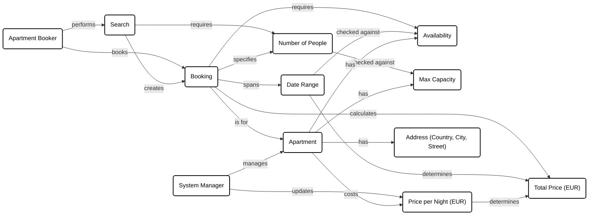

# Apartment Booking System — CLI and Flask API

[](https://github.com/SebastianoDruda/apartment-booking-cli/actions/workflows/tests.yml)
[](https://github.com/SebastianoDruda/apartment-booking-cli/actions/workflows/coverage.yml)
[](https://github.com/SebastianoDruda/apartment-booking-cli/actions/workflows/load-test.yml)

**By Sebastiano Druda, Tom Springer and Jacob Wieser**

Manage apartments, availability and bookings through the original interactive CLI
or a Flask HTTP API with an interactive documentation page. Both interfaces call the same `BookingDatabase` operations,
use the same SQLite schema and enforce the same validation and transaction rules.
The CLI remains standard-library-only; the optional web interface uses Flask.

**Latest tagged release:** [Checkpoint 02](https://github.com/SebastianoDruda/apartment-booking-cli/releases/tag/checkpoint-02)
 · **Python:** 3.10+
 · **Storage:** SQLite
 · **Interfaces:** terminal and local JSON API

The Flask interface is an incremental change after Checkpoint 02. The Checkpoint 01
and Checkpoint 02 tags are unchanged; their source archives do not include Flask.
**Updating an existing checkout?** Read the [database upgrade instructions](#database-location-backup-and-reset)
before pulling: older revisions tracked the database file in Git.

## Quick start with Docker

To start the HTTP interface, open Docker Desktop, then run from the project folder:

```bash
docker compose up --build web
```

Open **http://localhost:8000/docs** for the interactive API explorer,
**http://localhost:8000** for the JSON route overview, or
**http://localhost:8000/api/apartments** to inspect apartments. The service listens
only on the host's `127.0.0.1:8000`. Keep the terminal open; Ctrl+C stops the web
service without deleting data. For background operation use
`docker compose up --build -d web`, then `docker compose logs -f web` to follow logs.

This is a local API without authentication. Do not publish its port to the network
or enable the interactive debugger. See [Flask HTTP interface](#flask-http-interface)
for all endpoints, examples and local Python startup.

**The original interactive CLI is still available:**

1. Start **Docker Desktop** and wait for its engine to be running. On Windows,
   use Linux containers. Python does not need to be installed on your computer.
2. Open Terminal on macOS or PowerShell on Windows in the project folder containing
   [compose.yaml](compose.yaml) and [Dockerfile](Dockerfile).
3. Build and start the application using the same commands on either system:

   ```bash
   docker compose build --pull
   docker compose run --rm booking
   ```

4. Choose `1` for Apartment Booker or `2` for System Manager. Type `help` for commands.
5. Type `exit` to close the session. Next time, run `docker compose run --rm booking` again.

**Your Docker bookings persist between sessions.** The `booking` and `web` services
share the same `booking-data` volume, so changes through either interface are visible
to the other. This volume is separate from the database used by direct Python runs. Docker does
not automatically import your existing local records.

See the [complete Docker guide](#running-with-docker-and-compose) for installation,
backups, importing existing data, updates and troubleshooting.

Prefer to run without Docker? From the project folder:

| System | Start directly with Python 3.10+ |
| --- | --- |
| MacBook / macOS | `python3 main.py` |
| Windows | `py -3 main.py` (or `python main.py` if that is your installed interpreter) |

See [Starting the application](#starting-the-application) for the full Python instructions.

## Contents

- [Quick start with Docker](#quick-start-with-docker)
- [Features](#features)
- [Running with Docker and Compose](#running-with-docker-and-compose)
- [Flask HTTP interface](#flask-http-interface)
- [Requirements and installation](#requirements-and-installation)
- [Starting the application](#starting-the-application)
- [First booking walkthrough](#first-booking-walkthrough)
- [Roles and command reference](#roles-and-command-reference)
- [Input rules and booking behaviour](#input-rules-and-booking-behaviour)
- [Tab completion and terminal controls](#tab-completion-and-terminal-controls)
- [Repository structure](#repository-structure)
- [Architecture and data model](#architecture-and-data-model)
- [Domain concept map](#domain-concept-map)
- [Database location, backup and reset](#database-location-backup-and-reset)
- [Testing and continuous integration](#testing-and-continuous-integration)
- [Troubleshooting](#troubleshooting)
- [Current scope and limitations](#current-scope-and-limitations)
- [Contributing](#contributing)
- [Releases](#releases)
- [Authors and licensing](#authors-and-licensing)

## Features

- Two selectable roles: **System Manager** and **Apartment Booker**.
- Apartment creation with name, address, capacity and nightly price in EUR.
- Nightly price updates and apartment removal.
- Booking creation, date/guest-count changes and cancellation.
- Availability search by date range and party size, with booking directly from results.
- Real-calendar validation, capacity checks and overlapping-booking rejection.
- Persistent SQLite storage and automatically created tables.
- Contextual command help, terminal completion and dynamically sized output tables.
- Docker Compose startup with an interactive terminal and persistent database volume.
- Flask JSON endpoints for all apartment/booking operations, availability and health.
- Automated database, CLI, HTTP, concurrency and Docker checks.

## Running with Docker and Compose

Docker packages Python and this application together. The CLI commands, prompts and
booking rules are the same. `booking` runs the terminal CLI; `web` runs Flask on
localhost:8000. Both use SQLite in the existing named volume, without a separate
database server. The CLI service configuration and entry points are preserved.

The configuration is included in this repository:

| File | Purpose |
| --- | --- |
| [Dockerfile](Dockerfile) | Builds non-root `runtime` (CLI), `web` (Flask) and `test` targets; Flask is installed only in web/test images. |
| [compose.yaml](compose.yaml) | Defines interactive `booking`, non-interactive `web` and their shared `booking-data` volume. |
| [.dockerignore](.dockerignore) | Keeps local databases, backups and unrelated files out of the build context. |

Run Compose commands from the project folder; Compose reads `compose.yaml` automatically.

### 1. Install and start Docker

- **MacBook / macOS:** install [Docker Desktop for Mac](https://docs.docker.com/desktop/setup/install/mac-install/),
  choosing Apple silicon or Intel for your Mac. Open Docker Desktop and wait for its
  engine to be running.
- **Windows:** install [Docker Desktop for Windows](https://docs.docker.com/desktop/setup/install/windows-install/)
  and follow its WSL 2 setup instructions. Start Docker Desktop using **Linux containers**.
- **Linux:** install Docker Engine and the Docker Compose plugin using the
  [Docker installation instructions](https://docs.docker.com/engine/install/).

Check the installation in Terminal on macOS or PowerShell on Windows:

```bash
docker version
docker compose version
```

`docker version` must show a working **Server**, not just the client. Docker Desktop
includes Compose. The commands below use `docker compose` with a space.

### 2. Open the project folder

Open the folder containing `compose.yaml` and `Dockerfile` in your terminal. You can
use your existing checkout, or clone it with the Git commands in the installation
section below. In VS Code, open the project folder and choose **Terminal → New Terminal**.

### 3. Build the image

These commands are the same on macOS and Windows:

```bash
docker compose config --quiet
docker compose build --pull
```

The first build downloads the official `python:3.14-slim-bookworm` image. It builds
for your machine's architecture, including Apple silicon. Subsequent builds can
reuse cached layers. No account login is needed to build the application itself;
network access is needed to download the base image.

### 4. Start the interactive CLI

```bash
docker compose run --rm booking
```

Choose `1` for Apartment Booker or `2` for System Manager, then use the same commands
as in a normal Python session. `help`, `role`, Tab completion and `exit` still work.
Inside the Linux container, completion uses `readline`, including when Docker runs
on a Windows host.

Use [`docker compose run`](https://docs.docker.com/reference/cli/docker/compose/run/)
for the interactive CLI; `docker compose up -d booking` does not attach terminal
input. The separate HTTP service uses `docker compose up --build web`. `--rm` removes the session's container after it exits.

### 5. Exit and return later

Type `exit` inside the application. To start another session:

```bash
docker compose run --rm booking
```

Both Docker services store records at `/data/apartment_booking.db` in the same
Compose **`booking-data` named volume**. They survive container removal and image rebuilds because
[Docker volumes persist separately from containers](https://docs.docker.com/engine/storage/volumes/).

Docker starts with its own empty database. The root-level `apartment_booking.db`
used by direct Python runs remains separate and is never copied into the image or
imported automatically. Keep using the same Compose project/directory: changing
its project name (for example with `-p`) selects a different volume.

### 6. Rebuild after code changes

After updating the source, exit the CLI and run:

```bash
docker compose build --pull
docker compose run --rm booking
```

Source code is copied into the image at build time, so editing local files requires
a rebuild. Your Docker database is retained.

### 7. Run checks inside Docker

The test target builds the same application environment and runs all 43 tests:

```bash
docker build --target test --tag apartment-booking-cli:test .
```

The normal runtime image contains only the application, without tests or local data.
For maintainers with Python installed, the additional integration check is:

```bash
python3 tests/docker_smoke.py
python3 tests/docker_web_smoke.py
```

On Windows use `py -3` instead of `python3`. Each script uses its own randomly named
Compose project and disposable volume. The CLI check covers launchers, persistence,
backup/import and startup errors; the web check covers real HTTP requests, CLI/API
shared data, conflicts, localhost binding and restart persistence. Cleanup removes
**only the test project**, never your existing database volume.

### 8. Back up Docker data

Exit all booking sessions and stop web writes with `docker compose stop web` first.
After at least one application run has created the
database, create a stopped service container and copy the database out:

```bash
docker compose create booking
docker compose cp booking:/data/apartment_booking.db ./docker-booking-backup-01.db
```

These commands work in both macOS Terminal and Windows PowerShell. Choose a new
backup filename each time to avoid overwriting an earlier copy. The stopped service
containers and project network can be removed using:

```bash
docker compose down
```

This keeps the named data volume. **Do not add `--volumes` or `-v` to `down` unless
you intentionally want to delete the Docker database.** Backup files are ignored by Git.

### Optional: import a database before the first Docker session

To start with existing data, close the local application and copy its database to
`docker-booking-backup-01.db`, or use a backup exported above. Run this **before the
first application launch in a fresh Compose project**, after building the image.
It refuses to overwrite an existing Docker database.

From the repository root, in macOS Terminal or Windows PowerShell:

```bash
docker compose run --rm -T --volume "${PWD}/docker-booking-backup-01.db:/restore.db:ro" booking python -c "import os, sqlite3; from pathlib import Path; p=Path(os.environ['APARTMENT_BOOKING_DB_PATH']); assert not p.exists(), 'Destination database already exists; import cancelled'; source=sqlite3.connect('file:/restore.db?mode=ro', uri=True); destination=sqlite3.connect(p); source.backup(destination); destination.close(); source.close()"
```

The source backup must exist and be readable. It is mounted read-only and copied
using SQLite's backup API; the original file is unchanged. Then start the CLI with
`docker compose run --rm booking`. Import is optional; do not delete an existing
Docker volume merely to make room for an import without backing up its data first.

### Container configuration and troubleshooting

- The application runs as a non-root user. Compose makes its root filesystem
  read-only and mounts a writable data volume plus temporary `/tmp` storage.
- `.dockerignore` allows only source, tests and dependency specifications into the build context; local
  databases, backups, Git metadata and credentials are excluded.
- `APARTMENT_BOOKING_DB_PATH` selects the database file. The image sets it to
  `/data/apartment_booking.db`; direct Python runs retain the original root-level
  default when the variable is unset or empty. A custom parent directory must exist
  and be writable. Prefer an absolute path; relative paths use the working directory.
- **Cannot connect to the Docker daemon:** start Docker Desktop and wait for the
  engine, then retry `docker version`.
- **No configuration file found:** run commands from the folder containing `compose.yaml`.
- **Input or Tab does not work:** use `docker compose run --rm booking` in a real
  terminal. `-T` is intended for piped input/automation, not interactive completion.
- **No matching manifest / Windows image error:** switch Docker Desktop to Linux containers.
- **Empty apartment list:** a new Docker volume starts empty; it does not read your
  local Python database. Also check that you are using the same Compose project name.

## Flask HTTP interface

The web interface is a JSON API for local inspection and testing with a browser,
curl or Postman. The `/docs` page includes an API explorer built with local HTML, CSS
and JavaScript, with no external assets or frontend framework. It adds no authentication. GET requests only
read business data; writes require POST, PATCH or DELETE. The `/` URL returns a JSON
route overview rather than an HTML booking form.

### Start with Docker

```bash
docker compose up --build web
```

Then open:

- http://localhost:8000/docs — interactive documentation; edit and send GET/POST/PATCH/DELETE requests.
- http://localhost:8000/api/openapi.json — OpenAPI 3.1 specification.
- http://localhost:8000/ — API overview and route list.
- http://localhost:8000/api/health — HTTP and database readiness.
- http://localhost:8000/api/apartments — current apartments.
- http://localhost:8000/api/bookings — current bookings.
- http://localhost:8000/api/availability?start_date=2026-11-10&end_date=2026-11-15&num_people=2 — available apartments.

For background operation: `docker compose up --build -d web`. Inspect logs with
`docker compose logs -f web`, inspect readiness with `docker compose ps`, and stop
only the HTTP service with `docker compose stop web`. The CLI remains available:

```bash
docker compose run --rm booking
```

The `web` service uses no interactive terminal. Inside its Linux container it listens
on `0.0.0.0:8000`, while Compose publishes only `127.0.0.1:8000` on the host.
If that host port is already occupied, set `BOOKING_WEB_PORT` before starting:
`BOOKING_WEB_PORT=8001 docker compose up --build web` on macOS/Linux, or
`$env:BOOKING_WEB_PORT="8001"` followed by the normal Compose command in PowerShell.
The internal port remains 8000. Use the chosen host port in your browser.

### Start with Python on macOS

From the repository root:

```bash
python3 -m venv .venv
source .venv/bin/activate
python -m pip install -r requirements.txt
python -m flask --app src.web:create_app --no-debug run --host 127.0.0.1 --port 8000 --no-debugger --no-reload
```

### Start with Python on Windows

From PowerShell in the repository root, no activation is required:

```powershell
py -3 -m venv .venv
.\.venv\Scripts\python.exe -m pip install -r requirements.txt
.\.venv\Scripts\python.exe -m flask --app src.web:create_app --no-debug run --host 127.0.0.1 --port 8000 --no-debugger --no-reload
```

Ctrl+C stops the server. Locally, both Flask and the CLI use the root-level
`apartment_booking.db` unless `APARTMENT_BOOKING_DB_PATH` is set. Inside Compose,
both services use `/data/apartment_booking.db` in the **existing** `booking-data`
volume. No volume reset or database schema migration is needed. Direct Python
and Docker storage remain separate unless you explicitly import a backup.

### Try requests in the browser

Open http://localhost:8000/docs and select an endpoint from the sidebar. Edit its
path/query fields or JSON example, then press **Send GET**, **Send POST**, **Send PATCH**
or **Send DELETE**. The response panel shows the actual HTTP status, elapsed time
and formatted JSON. You can copy the response or the equivalent curl command.

The page sends nothing automatically: selecting an operation only loads its example.
Start with GET health or apartment listing, then create a uniquely named apartment
if you want to try writes. POST, PATCH and DELETE change the same real records used
by the CLI. For booking cancellation, enter the booking's current dates, including
any dates changed by an earlier PATCH. Examples use `API Demo`; replace that name
if it already exists. Reset example restores the request fields without changing data.

The explorer loads its request definitions from `/api/openapi.json`. The specification
can also be imported into an HTTP client. Contract tests check that it covers every
business endpoint, and all assets are served locally so the page works without a CDN.

### Endpoints and request fields

Send a JSON object with `Content-Type: application/json` for POST/PATCH and booking
DELETE requests. All listed fields are required; unknown fields are rejected.
Names and dates must be strings. Counts accept integers or whole-number strings
(not booleans/fractions). Prices accept numbers or the existing CLI formats such
as `"120,50 €"`. Apartment names in paths must be URL-encoded (space becomes `%20`).

| Method | Endpoint | Body or query fields | Success |
| --- | --- | --- | --- |
| GET | `/docs` | None | 200: interactive HTML documentation |
| GET | `/api/openapi.json` | None | 200: OpenAPI JSON specification |
| GET | `/` | None | 200: overview/routes |
| GET | `/api/health` | None | 200: server/database ready |
| GET | `/api/apartments` | None | 200: apartments |
| POST | `/api/apartments` | JSON: `name`, `country`, `city`, `street_and_number`, `max_people`, `price_per_night` | 201: created apartment |
| PATCH | `/api/apartments/<name>/price` | JSON: `price_per_night` | 200: updated apartment |
| DELETE | `/api/apartments/<name>` | None | 200: deleted apartment; its bookings are also deleted |
| GET | `/api/bookings` | None | 200: bookings |
| POST | `/api/bookings` | JSON: `apartment_name`, `start_date`, `end_date`, `booker_name`, `num_people` | 201: created booking |
| PATCH | `/api/bookings` | JSON: `apartment_name`, `start_date`, `end_date`, `new_start_date`, `new_end_date`, `num_people` | 200: changed booking |
| DELETE | `/api/bookings` | JSON: `apartment_name`, `start_date`, `end_date` | 200: cancelled booking |
| GET | `/api/availability` | Query: `start_date`, `end_date`, `num_people`, each exactly once | 200: available apartments |

For PATCH/DELETE bookings, `start_date` and `end_date` identify the **current** booking.
PATCH replaces the dates and guest count; it does not move the booking to another
apartment or change the booker's name. Past dates, calendar validation, adjacent
check-out/check-in, capacity, overlaps and current-price totals behave as in the CLI.

### curl walkthrough

The following examples use macOS/Linux shell quoting. They create and later remove
an example apartment and booking. Use a distinct name if `API Demo` already exists;
do not run write examples against records you want to preserve.

Read readiness and available data:

```bash
curl -i http://localhost:8000/api/health
curl http://localhost:8000/api/apartments
curl http://localhost:8000/api/bookings
curl "http://localhost:8000/api/availability?start_date=2026-11-10&end_date=2026-11-15&num_people=2"
```

Create an apartment (HTTP 201):

```bash
curl -i -X POST http://localhost:8000/api/apartments -H 'Content-Type: application/json' -d '{"name":"API Demo","country":"Italy","city":"Rome","street_and_number":"Example 1","max_people":3,"price_per_night":100}'
```

Update its price (HTTP 200), then create a booking (HTTP 201):

```bash
curl -i -X PATCH 'http://localhost:8000/api/apartments/API%20Demo/price' -H 'Content-Type: application/json' -d '{"price_per_night":120}'
curl -i -X POST http://localhost:8000/api/bookings -H 'Content-Type: application/json' -d '{"apartment_name":"API Demo","start_date":"2026-11-10","end_date":"2026-11-15","booker_name":"Demo Guest","num_people":2}'
```

Change the booking (HTTP 200):

```bash
curl -i -X PATCH http://localhost:8000/api/bookings -H 'Content-Type: application/json' -d '{"apartment_name":"API Demo","start_date":"2026-11-10","end_date":"2026-11-15","new_start_date":"2026-11-11","new_end_date":"2026-11-16","num_people":3}'
```

Cancel it using the new dates, then remove the apartment (HTTP 200):

```bash
curl -i -X DELETE http://localhost:8000/api/bookings -H 'Content-Type: application/json' -d '{"apartment_name":"API Demo","start_date":"2026-11-11","end_date":"2026-11-16"}'
curl -i -X DELETE 'http://localhost:8000/api/apartments/API%20Demo'
```

On Windows PowerShell, use **`curl.exe`** (avoids the legacy `curl` alias). GET
commands work directly. For JSON writes, save the JSON object from an example as
`request.json` in UTF-8 without a BOM, then avoid native-argument quoting issues with:

```powershell
curl.exe -i -X POST http://localhost:8000/api/apartments -H "Content-Type: application/json" --data-binary "@request.json"
```

Use the same file technique with PATCH/DELETE and the appropriate JSON fields.
Alternatively, in Postman choose the method/URL and **Body → raw → JSON**.

### Responses, errors and logs

Success responses wrap their result in `data`; lists are arrays (possibly empty):

```json
{"data": {"status": "ok", "database": "ok"}}
```

Errors use a consistent shape, with a readable message and machine-readable code:

```json
{"error": {"code": "conflict", "message": "Apartment 'API Demo' already exists."}}
```

| Status | Meaning |
| --- | --- |
| 200 / 201 | Successful read/update/delete or creation |
| 400 | Invalid JSON/object, missing/unknown fields, invalid dates, price or capacity |
| 404 | Apartment/booking or route not found |
| 405 | HTTP method not allowed; response includes `Allow` |
| 409 | Duplicate apartment, overlapping booking or integrity conflict |
| 413 | JSON body exceeds 64 KiB |
| 415 | Write request is not sent as JSON |
| 503 | Database unavailable/locked; retry after resolving storage access (`Retry-After: 1`) |
| 500 | Unexpected failure; inspect server logs |

Application logs include HTTP method, route template, status and duration. Unexpected
and storage failures include diagnostic server logs; HTTP responses never expose
Python tracebacks or internal database error details. Flask/Werkzeug also writes
request access logs. Responses use `Cache-Control: no-store`.

The API is **unauthenticated and for local development only**. Anyone with local
access can create, modify or delete records; CLI role selection is not HTTP access
control. No CORS support is added. Keep the default loopback host binding, debugger
off and reloader off. The Flask development server is not a public production server.

## Requirements and installation

For the Docker option, follow [Running with Docker and Compose](#running-with-docker-and-compose);
you do not need Python installed on your host. The requirements below are for running Python directly.

- **Python 3.10 or newer**, with the standard-library `sqlite3` module.
- A terminal, such as the VS Code integrated terminal, Terminal on macOS/Linux,
  or PowerShell on Windows.
- Git for cloning and contributing. Downloading a source archive is also possible,
  but archives do not contain Git history or a configured remote.
- Access to this repository on GitHub; it is currently private.

Clone the repository and enter its root directory:

```bash
git clone https://github.com/SebastianoDruda/apartment-booking-cli.git
cd apartment-booking-cli
```

The CLI requires no dependency installation. Flask and the complete test suite
require `python -m pip install -r requirements.txt`; use a virtual environment as
described in the HTTP section. Direct CLI commands below remain unchanged.

## Starting the application

Open a terminal **in the repository root**, the folder containing `main.py` and
`README.md`. If you downloaded a ZIP, extract it first: the folder may be named
`apartment-booking-cli-main` instead of `apartment-booking-cli`. In VS Code, open
that folder and choose **Terminal → New Terminal**.

### MacBook / macOS

In Terminal or the VS Code integrated terminal, check Python and start the app:

```bash
python3 --version
python3 -c "import sqlite3; print(sqlite3.sqlite_version)"
python3 main.py
```

The reported Python version must be **3.10 or newer**. The alternate launcher is:

```bash
python3 src/main.py
```

If your terminal is in a different folder, first use
`cd "/full/path/to/apartment-booking-cli"`, replacing the example with the actual
folder path. Keep the quotes if the path contains spaces. The same commands work
on Linux with a compatible Python installation.

### Windows

In PowerShell, Command Prompt or the VS Code integrated terminal:

```powershell
py -3 --version
py -3 -c "import sqlite3; print(sqlite3.sqlite_version)"
py -3 main.py
```

The reported Python version must be **3.10 or newer**. The alternate launcher is:

```powershell
py -3 src/main.py
```

If `py` is unavailable but Python is installed and available as `python`, use:

```powershell
python --version
python -c "import sqlite3; print(sqlite3.sqlite_version)"
python main.py
```

Check that this also selects Python 3.10+. If neither `py` nor `python` works,
install Python 3.10+ with SQLite support and reopen the terminal. If `python` opens
the Microsoft Store, try `py -3` or select your installed interpreter in VS Code.

### Optional virtual environment

No virtual environment is required, but you can isolate the interpreter locally.
From the repository root on macOS:

```bash
python3 -m venv .venv
source .venv/bin/activate
python main.py
```

From the repository root in Windows PowerShell, you can run the environment's
interpreter directly, without changing PowerShell's script execution policy:

```powershell
py -3 -m venv .venv
.\.venv\Scripts\python.exe main.py
```

The CLI itself needs no third-party packages. Install `requirements.txt` in your
environment for Flask and the full test suite. Use the same interpreter for running
the application and its tests.

### Inside the application

Both entry points start the same CLI and use the same root-level database. Startup
shows an overview of commands, followed by role selection. Choose `1` for Apartment
Booker or `2` for System Manager. Type `help` to see commands for your active role,
`role` to switch roles, and `exit` to finish.

Commands such as `apartment add` are entered **inside the running application**;
they are not shell commands or command-line arguments.

## First booking walkthrough

The following example uses an apartment named `Alpine View`. If that name already
exists in your database, choose a different name throughout the example. These
steps create persistent records in your local database.

1. Start the application and select `2` (System Manager).
2. Enter `apartment add`, then answer its prompts in order:

   | Prompt | Example value |
   | --- | --- |
   | Apartment name | `Alpine View` |
   | Country | `Germany` |
   | City | `Munich` |
   | Street and house number | `Bergstrasse 12` |
   | Maximum number of people | `4` |
   | Price per night (euros) | `120` |

3. Enter `apartment view` to check the new apartment.
4. Enter `role`, then select `1` (Apartment Booker).
5. Enter `apartment search` and supply `2027-08-10`, `2027-08-15`, and `3` people.
6. The matching result shows **5 nights × 120.00 EUR = 600.00 EUR**. Enter
   `Alpine View` when asked which apartment to book, followed by your name.
   Press Enter at the apartment-selection prompt to leave without booking instead.
7. Enter `booking view` to inspect the saved booking.
8. To change it, use `booking change`: identify the apartment and its current
   date range, then provide the new dates and guest count.
9. To cancel it, use `booking cancel` with the apartment name and its **current**
   date range. Enter `exit` when finished.

## Roles and command reference

Command names are case-insensitive; leading/trailing and repeated spaces are
normalised. All command data is collected through subsequent interactive prompts.

### Role selection

| Role | Accepted inputs |
| --- | --- |
| Apartment Booker | `1`, `apartment booker`, `booker`, `b` |
| System Manager | `2`, `system manager`, `manager`, `m`, `admin` |
| Exit at role selection | `exit`, `quit`, `q` |

Roles select available operations; they are not password-protected user accounts.

### System Manager

| Command | Aliases | Behaviour |
| --- | --- | --- |
| `apartment add` | — | Ask for name, country, city, street/house number, capacity and nightly price. |
| `apartment update` | — | Change only an existing apartment's nightly price, identified by name. |
| `apartment remove` | `apartment delete` | Immediately delete the named apartment **and all its bookings**. There is no confirmation prompt or undo. |

### Apartment Booker

| Command | Aliases | Behaviour |
| --- | --- | --- |
| `booking create` | `booking add` | Ask for apartment name, check-in, check-out, booker name and guest count; check availability and capacity. |
| `booking change` | `booking update`, `booking edit` | Find a booking by apartment name and current dates; replace its dates and guest count. |
| `booking cancel` | `booking remove`, `booking delete` | Immediately delete the booking identified by apartment name and dates; no confirmation prompt. |
| `apartment search` | `booking search`, `search` | Find available apartments for dates and guest count, then optionally book one of the results. |

### Shared commands

| Command | Aliases | Behaviour |
| --- | --- | --- |
| `apartment view` | `apartment list`, `apartments` | List apartments alphabetically, including address, capacity and nightly price. |
| `booking view` | `booking list`, `bookings` | List all bookings with apartment and booker details, dates, guest counts and totals. |
| `help` | — | Show commands available to the active role. |
| `role` | `switch`, `switch role` | Select a different role without restarting. |
| `exit` | `quit`, `q` | Close the CLI. |

A command reserved for the other role produces an access-denied message; switch
roles to use it. Both roles can view **all** bookings.

## Input rules and booking behaviour

### Dates and availability

| Accepted format | Example | Stored value |
| --- | --- | --- |
| `YYYY-MM-DD` | `2027-08-10` | `2027-08-10` |
| `DD.MM.YYYY` | `10.08.2027` | `2027-08-10` |
| `DD/MM/YYYY` | `10/08/2027` | `2027-08-10` |
| `YYYY/MM/DD` | `2027/08/10` | `2027-08-10` |

Dates are checked against the calendar, including leap years. For example,
`2026-09-31` is rejected because September has 30 days; `2028-02-29` is valid.
Check-out must be strictly later than check-in. Past dates are currently accepted.

Stays use a check-in-inclusive, check-out-exclusive interval. Two bookings overlap
when `requested_start < existing_end` **and** `requested_end > existing_start`.
A new guest may therefore check in on another guest's check-out date. Changing a
booking excludes that booking itself from the overlap check.

Search returns apartments with sufficient capacity and no overlapping bookings,
ordered by nightly price and then apartment name. Availability is checked again
when creating the booking. At the search-result selection prompt, Enter, `no`, `n`,
`skip` or `cancel` finishes the search without booking.

### Names, address, guests and prices

- Apartment names must be non-empty and unique under SQLite's `NOCASE` comparison.
  Lookups also use `NOCASE` (case folding is primarily for ASCII characters).
- Country, city and street/house number are required and stored together as
  `Country, City, Street and house number`. There is no external address verification.
- Booker names must be non-empty. They are labels, not authenticated identities.
- Capacity and guest counts must be positive whole numbers; bookings cannot exceed
  apartment capacity.
- The CLI accepts prices such as `120`, `120.50`, `120,50` and `120 €`, normalises
  the decimal separator and rounds to two decimal places. Prices must be finite and
  remain positive after rounding; `nan`, infinity and values that round to zero are rejected.
- Nights are the difference between check-out and check-in; totals are calculated
  as `round(nights * price_per_night, 2)` in EUR. Totals that overflow to infinity
  are rejected before a booking is created or changed.
- **Booking prices are not locked in.** Bookings do not store a historical nightly
  price: viewing them uses the apartment's current price. Updating that price also
  changes displayed totals for existing bookings.

## Tab completion and terminal controls

Completion suggestions cover roles, commands for the active role, and apartment
names where applicable. Search selection suggests only matching available apartments.
Matching prefers case-insensitive prefixes, then substring matches.

- On Windows interactive terminals, the custom `msvcrt` input handler cycles through
  matches on repeated Tab presses and supports Backspace.
- On macOS/Linux, completion uses `readline` when available. The exact completion
  behaviour depends on the terminal/readline backend; cycling is not guaranteed.
- Without a supported completion backend, or when stdin is redirected, enter full
  text normally. Completion is optional for all operations.
- At the command prompt or role selection, Ctrl+C or end-of-input exits the CLI.
  During a command's input prompts it aborts that operation and returns to the loop.

## Repository structure

The current layout suits this small CLI: terminal interaction, persistence and tests
already have distinct locations and descriptive filenames. `main.py` is the short
root launcher; `src/main.py` contains startup and also supports direct execution.
Keeping both preserves the documented launch commands. Keeping the database in the
root preserves its existing location and data. Additional package layers or renamed
modules are unnecessary at this size; documentation and automation remain separate
from application code.

```text
apartment-booking-cli/
├── .github/
│   ├── pull_request_template.md    # Review and validation checklist
│   └── workflows/
│       └── tests.yml               # Standard-library test suite on GitHub Actions
├── .dockerignore                  # Allowlist for the Docker build context
├── Dockerfile                     # Non-root Python runtime and test build target
├── compose.yaml                   # CLI + web services sharing a persistent database
├── .gitignore                     # Local environments, caches and temporary data
├── README.md                      # Setup, usage, architecture and maintenance
├── CHANGELOG.md                   # Checkpoint release history
├── CONTRIBUTING.md                # Contributor workflow and checks
├── apartment_booking.db           # Local SQLite database, created on first run (ignored)
├── domain_concept_map.png         # Existing domain diagram image
├── requirements.txt               # Pinned Flask dependency for web/full tests
├── main.py                        # Original root CLI launcher
├── src/
│   ├── __init__.py                 # Package marker
│   ├── main.py                     # Alternate launcher and CLI startup
│   ├── cli.py                      # Prompts, roles, commands and output formatting
│   ├── web.py                      # Flask factory, HTTP parsing, routes and error handling
│   ├── api_docs.py                 # OpenAPI contract and explorer request examples
│   ├── templates/
│   │   └── api_docs.html           # Interactive API documentation page
│   ├── static/
│   │   ├── api_docs.css            # Responsive documentation styling
│   │   └── api_docs.js             # Same-origin request console
│   └── database.py                 # SQLite persistence and business validation
└── tests/
    ├── test_booking_system.py      # Original database, CLI and completion tests
    ├── test_robustness.py          # Prices, atomic writes and storage-error regressions
    ├── test_database_path.py       # Optional storage path and launcher compatibility
    ├── test_web.py                 # Isolated HTTP, parity and concurrent request tests
    ├── docker_smoke.py             # Isolated CLI Docker checks (run separately)
    └── docker_web_smoke.py         # Isolated HTTP/CLI Docker checks (run separately)
```

## Architecture and data model

`main.py` delegates to `src.main.main()`, which creates `ApartmentBookingCLI`.
The CLI handles input, command dispatch and presentation. `BookingDatabase` handles
persistence, apartment/booking operations, availability and validation.

`src.web.create_app()` adds a Flask presentation layer. Routes validate HTTP field
types and delegate to the same `BookingDatabase` methods; they contain no SQL.
The price parser and address formatter are shared with the CLI. Domain exceptions
remain subclasses of `ValueError`, preserving CLI compatibility while allowing
HTTP to distinguish validation errors, missing records and conflicts.

```text
HTTP client -> Flask routes --------+
                                   +-> BookingDatabase -> SQLite
Terminal ----> ApartmentBookingCLI -+
```

Flask creates a request-local database wrapper and closes it on teardown. SQLite
connections are never shared between HTTP threads. Existing `BEGIN IMMEDIATE`
transactions still protect validation and writes. There are no schema changes.
The factory accepts `DATABASE_PATH` in its config so tests can use isolated files.

`ApartmentBookingCLI` accepts an injected database, input function and output stream,
so the tests can exercise interactive workflows without a real terminal.
`BookingDatabase` accepts a custom path or `:memory:` for isolated usage.

### SQLite schema

| Table | Columns and constraints |
| --- | --- |
| `apartments` | `id` INTEGER primary key/autoincrement; `name` TEXT required, unique with `NOCASE`; `address` TEXT required; `max_people` INTEGER required and > 0; `price_per_night` REAL required and > 0. |
| `bookings` | `id` INTEGER primary key/autoincrement; `apartment_id` INTEGER required; `booker_name`, `start_date`, `end_date` TEXT required; `num_people` INTEGER required and > 0. |

`bookings.apartment_id` references `apartments.id` with `ON DELETE CASCADE`.
Foreign keys are enabled on application connections. Tables are created with
`CREATE TABLE IF NOT EXISTS` when the database is opened. There is no schema migration
framework. Dates are stored as ISO text; nights and total prices are derived values.
Availability, date validity and apartment-capacity checks are implemented in Python.
Write operations use `BEGIN IMMEDIATE` to keep their reads, validation and changes
inside one transaction. A second writer waits before checking availability, so
simultaneous booking creation/changes through this application cannot both reserve
the same dates. Failed operations roll back; the existing schema is unchanged.
If SQLite's lock timeout is reached, the CLI reports the error and lets you retry.

## Domain concept map

The diagram below describes the domain relationships. The original
[PNG concept map](domain_concept_map.png) is also available for viewers that do not
render Mermaid.



## Database location, backup and reset

The default path is resolved relative to the source files:
`<repository root>/apartment_booking.db`. It does not depend on the shell's current
working directory. Both launchers use this path. Successful operations commit to
SQLite immediately; restarting preserves the data.

**The current branch keeps `apartment_booking.db` local and ignored by Git.**
New clones start with an empty database created on first launch. Existing local
databases use the same path and schema; no data migration or reset is required.

**Upgrading from Checkpoint 01 or an older checkout:** those revisions tracked the
database. Before `git pull` or switching revisions, close the application and back
up `apartment_booking.db` using the command below. Git can remove an unchanged
tracked file when applying the commit that stops tracking it, or refuse the update
if it has local modifications. Preserve your backup before resolving that situation.
After updating, restore the backup to `apartment_booking.db` before launching if you
want to retain your records. Do not use a hard reset to resolve database changes.

Stopping tracking does not erase the database from older commits or the Checkpoint 01
source archive. Keep future local bookings out of Git; the existing release is unchanged.

Before a reset or data-changing experiment, close every application instance and
make a backup. From the repository root on macOS, this creates a timestamped copy:

```bash
python3 -c "from datetime import datetime; from shutil import copy2; copy2('apartment_booking.db', 'apartment_booking.backup-' + datetime.now().strftime('%Y%m%d-%H%M%S-%f') + '.db')"
```

On Windows, use the same command with `py -3` instead of `python3` (or `python`
if that is your selected interpreter). Keep this backup outside Git.

To start empty, keep your backup and move the working `apartment_booking.db` out of
the repository while the application is closed. The next launch creates an empty
database automatically. To restore, close the application and copy your chosen backup
back to `apartment_booking.db`, preserving the current file first if you need it.

The ignore rules exclude local `.db` files, backups and SQLite sidecar files.
Review `git status` before committing and do not force-add personal booking data.
The tests use in-memory or temporary databases and do not modify your local file.
There are no new CLI options. Set `APARTMENT_BOOKING_DB_PATH` before starting Python
to select another database file, or pass a path to the `BookingDatabase` constructor.
An unset or empty environment variable keeps the original root-level path. Docker
sets this variable to its persistent volume path; see the Docker guide above.

## Testing and continuous integration

Run from the repository root with the interpreter used to start the application.

**MacBook / macOS:**

```bash
python3 -m unittest discover -s tests -v
```

**Windows:**

```powershell
py -3 -m unittest discover -s tests -v
```

If you use `python` instead, including an activated virtual environment:

```bash
python -m unittest discover -s tests -v
```

For the optional Windows environment without activation:

```powershell
.\.venv\Scripts\python.exe -m unittest discover -s tests -v
```

Install the pinned web dependency first (`python -m pip install -r requirements.txt`,
or `python3`/`py -3` for your interpreter). The current suite contains **43 tests** across:

| Test class | Coverage |
| --- | --- |
| `TestBookingDatabase` | Calendar validation, apartment operations and persistence, booking creation, overlap/capacity checks, booking changes/cancellation and availability search. |
| `TestTabAutocompletion` | Matching, completion cycling and character-input rendering using simulated keystrokes. |
| `TestApartmentBookingCLI` | Complete command workflows, role-specific help and dynamic table alignment. |
| `TestPriceValidation` | Invalid/non-finite prices, accepted price formats, CLI recovery, total overflow and unchanged current-price calculations. |
| `TestAtomicWrites` | Rollback and connection reuse, plus concurrent creation and changes using independent SQLite connections. |
| `TestDatabaseErrorHandling` | Recoverable storage errors, actual database locking, startup failure, cleanup and propagation of programming errors. |
| `TestDatabasePath` | Default-path compatibility, configurable storage across both launchers and missing-directory errors. |
| `TestWebAPI` | Endpoint lifecycle, HTTP errors, unchanged GET data, CLI parity, persistence, concurrency, documentation assets and OpenAPI coverage/examples. |

For one test class on macOS:

```bash
python3 -m unittest discover -s tests -p test_booking_system.py -k TestBookingDatabase -v
```

On Windows, replace `python3` with `py -3` (or your chosen Python interpreter).

[GitHub Actions](https://github.com/SebastianoDruda/apartment-booking-cli/actions/workflows/tests.yml)
runs this same suite on pushes and pull requests to `main`, and through manual
workflow dispatch. The matrix uses Python 3.10 and 3.14 on Linux, macOS and Windows.
A separate Docker job builds/tests both images, runs the original CLI smoke check
and verifies the real HTTP service, shared data and restart persistence.

The separate [code coverage workflow](https://github.com/SebastianoDruda/apartment-booking-cli/actions/workflows/coverage.yml)
runs the complete suite on every push and pull request to `main`, measures statement
and branch coverage, and fails below **85%**. Its workflow summary contains the text
report, while the downloadable `python-coverage-report` artifact contains XML and
HTML reports and is retained for 14 days. Both workflows can also be started manually
from the Actions tab.
These automated checks do not replace manual testing of real-terminal completion.

### API load testing with Locust

The [Locust scenario](tests/locustfile.py) exercises the primary domain journey:
list apartments, search availability, create and list a booking, change it, and
cancel it. Each simulated user owns a uniquely named apartment and removes its
test data on exit, so users cannot conflict with one another or pollute the normal
database.

To inspect the load test interactively, start the web service and install the
separate load-test dependency:

```bash
docker compose up --build --detach --wait web
python3 -m pip install -r requirements-load.txt
python3 -m locust --locustfile tests/locustfile.py --host http://127.0.0.1:8000
```

Open http://localhost:8089 for the Locust UI. Stop the API afterwards with
`docker compose stop web`. The [automated load-test workflow](https://github.com/SebastianoDruda/apartment-booking-cli/actions/workflows/load-test.yml)
runs headlessly on every push and pull request to `main` with 10 users for 30 seconds.
It fails if requests exceed 1% failures, 500 ms average response time, or 1,000 ms
p95 response time. Its HTML and CSV reports are retained as a downloadable artifact
for 14 days.

## Troubleshooting

| Symptom | What to check |
| --- | --- |
| `python` is not found or selects an old version | Try `python3` on macOS/Linux or `py -3` on Windows; confirm version 3.10+. |
| `No module named sqlite3` | Use a Python installation that includes SQLite support; this module is part of the standard library. |
| `main.py` cannot be found, or tests discover nothing | Run the documented commands from the repository root. |
| Git clone says repository not found or permission denied | Confirm that your GitHub account has access to this private repository and Git authentication is configured. |
| Tab does nothing or behaves differently | Use an interactive terminal; completion depends on `msvcrt`/`readline`. Typing full commands and names still works. |
| Access denied for a command | Enter `role` and select the role shown in the command reference. |
| Invalid date, overlap or insufficient capacity | Check the actual calendar, ensure check-out follows check-in, inspect bookings, and select dates/capacity that fit. |
| Apartment already exists | Names are unique under SQLite `NOCASE`; view existing apartments or use another name. |
| Booking cannot be found for change/cancellation | Use the apartment name and exact current start/end dates, including any previous changes. |
| Database is locked or read-only | The CLI reports the failure and returns to the prompt. Close other writers or fix folder/database permissions, then retry. A startup failure prints a message and exits with status 1. |
| A booking total changed | Totals use the apartment's current nightly price; they are recalculated when viewed. |
| Git reports `apartment_booking.db` modified | You may still be on an older revision that tracks it. Follow the database upgrade/backup instructions before updating; current `main` ignores it. |

## Current scope and limitations

The application supports the original CLI and a local Flask HTTP interface. Its roles are a user-interface feature:
there is no authentication, per-user booking ownership or access isolation. Any user
can switch roles, and both roles can inspect all bookings. Apartment removal cascades
to bookings, and deletion operations have no undo.

Prices use Python floats and SQLite REAL, with no stored booking-time rate, taxes,
payment processing or invoices. Dates have no time-of-day/time-zone handling and no
future-only restriction. Apartment updates change the price only; booking changes
change dates and guest count only.

Application write transactions protect booking availability against simultaneous
CLI writers. Direct SQL writes from other tools can bypass the Python validation;
there is no database-level overlap constraint. SQLite still allows only one writer
at a time. Flask uses its development server with debugging/reloading disabled by
default. The API has no authentication, user ownership or production hosting setup;
any local HTTP client can perform all operations. There is no automated backup or
schema migration tooling. Keep HTTP bound to localhost and do not expose it publicly.

## Contributing

See [CONTRIBUTING.md](CONTRIBUTING.md) for the branch workflow, required checks,
repository conventions and database-handling guidance. Keep changes focused and
preserve the existing source layout unless a restructuring is explicitly agreed.

## Releases

The Flask interface is currently on `feature/flask-http-interface` pending PR review;
it is not included in the existing release tags below.

[Checkpoint 02](https://github.com/SebastianoDruda/apartment-booking-cli/releases/tag/checkpoint-02)
uses the Git tag `checkpoint-02`. It includes Docker Compose with persistent storage,
price validation and transaction fixes, 25 automated tests, Docker integration checks,
and expanded macOS/Windows instructions. See [CHANGELOG.md](CHANGELOG.md) for details.

[Checkpoint 01](https://github.com/SebastianoDruda/apartment-booking-cli/releases/tag/checkpoint-01)
remains available under `checkpoint-01` as the original CLI checkpoint. When upgrading
from it, follow the [database backup instructions](#database-location-backup-and-reset)
before updating: Checkpoint 02 no longer tracks the runtime database.

GitHub provides source archives for each tag. Checkpoint 02 includes the Dockerfile
and Compose configuration; build the image locally using the Docker guide above.
No prebuilt image is published to a container registry, and no separate executable
or Python package is required. Direct Python startup remains supported.

## Authors and licensing

Created by **Sebastiano Druda, Tom Springer and Jacob Wieser**.

No license file is currently included. This checkpoint does not introduce a license;
contact the authors to clarify permission for reuse or redistribution.
