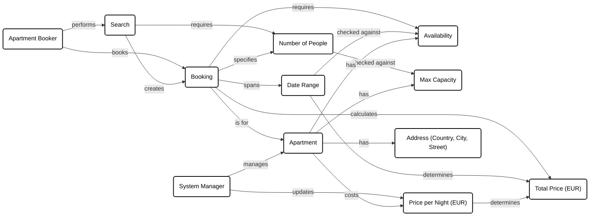

# Apartment Booking System (CLI)

A console-based Apartment Booking System written in Python with persistent SQLite storage. It can be started and controlled directly in the VS Code integrated terminal or any standard command-line console.

---

## Domain Concept Map



---

## How the System Works

1. **Startup & Role Selection**:
   When you start the program, the system first asks whether you are an **apartment booker** (`1` / `apartment booker`) or a **system manager** (`2` / `system manager`). You can also switch roles at any time during a session using the `role` command.
2. **Tab Key (`Tab`) Autocompletion**:
   In the console, you can press the **`Tab`** key on your keyboard at any time to autocomplete:
   - **Roles** (`apartment booker`, `system manager`)
   - **Commands** (e.g., typing `ap` + `Tab` or `booking c` + `Tab` cycles through matching commands)
   - **Apartment Names** (when updating, removing, creating/changing/cancelling a booking, or choosing an available apartment from search results — press `Tab` to autocomplete the apartment name or press `Tab` repeatedly to cycle through matching apartments)
3. **Persistent Database**:
   All apartments and bookings are stored in a local SQLite database file (`apartment_booking.db` in the project root). Restarting the program preserves all apartments and bookings automatically.
4. **Automatic Availability, Capacity & Calendar Validation**:
   Whenever a booking is created, changed, or searched:
   - **Capacity Check**: The system checks that the apartment's maximum capacity (`max_people`) is large enough for the number of people staying.
   - **Date Overlap Check**: The system ensures there is no overlapping booking for the same apartment during the requested date range (`start_date < existing_end_date` and `end_date > existing_start_date`). Adjacent check-out / check-in dates (e.g. checking out on `2026-08-05` and the next guest checking in on `2026-08-05`) are allowed.
   - **Calendar Month/Day Check**: Every entered date is checked against the real calendar for that specific month and year (for example, `2026-09-30` is valid, whereas `2026-09-31` or `31.09.2026` is rejected with an explicit message that September only has 30 days).

---

## Requirements & Starting the Program

- **Python 3.10+** (uses only Python's standard library — no external packages need to be installed).

Run the program from the console / VS Code terminal using either:

```bash
python main.py
```

or:

```bash
python src/main.py
```

---

## All Available Commands

At the command prompt, type any of the following commands (or use `Tab` to autocomplete) and follow the interactive prompts.

### System Manager Commands

| Command | Alias(es) | Description |
| :--- | :--- | :--- |
| `apartment add` | — | Add a new apartment by entering its **name**, standardized address (**country**, **city**, **street and house number**), **maximum number of people**, and **price per night (EUR)**. |
| `apartment update` | — | Update the **price per night (EUR)** of an existing apartment by entering the apartment's name (`Tab` autocomplete supported) and new price. |
| `apartment remove` | `apartment delete` | Remove an apartment from the system by entering the **apartment name** (`Tab` autocomplete supported). |
| `apartment view` | `apartment list`, `apartments` | View all apartments (without bookings), showing name, address, maximum capacity, and price per night in EUR. |
| `booking view` | `booking list`, `bookings` | View all bookings together with the booked apartment's details. |

### Apartment Booker Commands

| Command | Alias(es) | Description |
| :--- | :--- | :--- |
| `booking create` | `booking add` | Create a new booking by entering the **apartment name** (`Tab` autocomplete supported), **start & end dates**, **your name**, and **number of people**. Checks availability and capacity before booking. |
| `booking view` | `booking list`, `bookings` | View all bookings for all apartments together with the booked apartment's details. |
| `booking change` | `booking update`, `booking edit` | Change an existing booking by entering the **apartment name** (`Tab` autocomplete supported) and **current booked date range**, then entering the **new date range** and **new number of people**. Validates capacity and date overlap before saving. |
| `booking cancel` | `booking remove`, `booking delete` | Cancel a booking by entering the **apartment name** (`Tab` autocomplete supported) and the **booked date range**. |
| `apartment view` | `apartment list`, `apartments` | View all apartments (without bookings). |
| `apartment search` | `booking search`, `search` | Search for available apartments during a specific **date range** and for a specific **number of people**. Shows all matching available apartments and lets you directly book one by entering the **apartment name** (`Tab` autocomplete supported) and **your name**. |

### General Commands (Available to Both Roles)

| Command | Alias(es) | Description |
| :--- | :--- | :--- |
| `help` | — | Display all available commands with their descriptions. |
| `role` | `switch` | Switch between **apartment booker** and **system manager** without restarting the program. |
| `exit` | `quit`, `q` | Close the Apartment Booking System. |

---

## Supported Date Formats & Month/Day Validation

When entering dates for bookings or searches, you can use:
- `YYYY-MM-DD` (e.g., `2026-09-30`)
- `DD.MM.YYYY` (e.g., `30.09.2026`)

The system validates:
- The month is between `1` and `12`.
- The day exists in that exact month and year (e.g., April, June, September, and November only allow up to day `30`; February checks for `28` vs `29` days in leap years). Entering `2026-09-31` or `31.09.2026` immediately reports: `Invalid date '2026-09-31': September 2026 only has 30 days (day 31 is not possible).`
- All dates are stored in ISO format (`YYYY-MM-DD`), and the end date (check-out) must be after the start date (check-in).

---

## Example Console Walkthrough

```text
============================================================
       WELCOME TO THE APARTMENT BOOKING SYSTEM
============================================================

Please select your role (Tip: press Tab to autocomplete):
  [1] apartment booker
  [2] system manager
Are you an apartment booker or a system manager? system manager

Logged in as: System Manager.
Type 'help' to see all available commands (press Tab to autocomplete commands and apartment names).

[Manager] > apartment add

--- Add New Apartment ---
Apartment name: Alpine View
Country: Germany
City: Munich
Street and house number: Bergstrasse 12
Maximum number of people: 4
Price per night (euros): 120
[Success] Apartment 'Alpine View' at 'Germany, Munich, Bergstrasse 12' added (Max people: 4, Price/night: 120.00 EUR).

[Manager] > role

Please select your role (Tip: press Tab to autocomplete):
  [1] apartment booker
  [2] system manager
Are you an apartment booker or a system manager? apartment booker

Logged in as: Apartment Booker.
Type 'help' to see all available commands (press Tab to autocomplete commands and apartment names).

[Booker] > apartment search

--- Search Available Apartments ---
From date (YYYY-MM-DD): 2026-08-10
To date (YYYY-MM-DD): 2026-08-15
Number of people staying: 3

Available apartments from 2026-08-10 to 2026-08-15 for 3 people:
--------------------------------------------------------------------------------------------------------
Apartment Name         | Address (Country, City, Street)    | Max People | Price/Night  | Total Price 
--------------------------------------------------------------------------------------------------------
Alpine View            | Germany, Munich, Bergstrasse 12    | 4          |   120.00 EUR |   600.00 EUR (5n)
--------------------------------------------------------------------------------------------------------

Enter the name of the apartment you want to book (or press Enter to skip): Alpine View
Enter your name to complete the booking: Max Mustermann
[Success] Apartment 'Alpine View' is booked for Max Mustermann (3 people) from 2026-08-10 to 2026-08-15 (5 nights, Total: 600.00 EUR).
```

---

## Running Tests

To run the automated unit and CLI integration tests:

```bash
python -m unittest discover -s tests -v
```
